<div align="center">

<h1 align="center">CLAIRE</h1>

<h3 align="center">Clinically-Aligned and Auditable Quality Evaluation<br>for Dental CBCT Reconstruction</h3>

<p align="center">Anatomy-aware evaluation &nbsp;·&nbsp; Observation-locked reasoning &nbsp;·&nbsp; A two-track benchmark</p>

<p align="center">
<a href="https://ricoleehduu.github.io/CLAIRE/"></a>
<a href="https://ricoleehduu.github.io/CLAIRE/lab/"></a>


</p>

<p align="center">
<b><a href="https://ricoleehduu.github.io/CLAIRE/">Project page</a></b> ·
<b><a href="https://ricoleehduu.github.io/CLAIRE/lab/">Evidence Lab</a></b> ·
<b><a href="#3d-reference-anatomy">3D atlas</a></b> ·
<b><a href="#repository-layout">Layout</a></b> ·
<b><a href="#citation">Citation</a></b>
</p>

</div>

<p align="center">
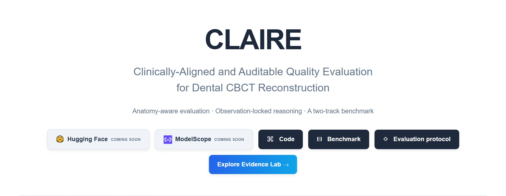
</p>

---

**CLAIRE** evaluates the quality of metal-artifact-reduced dental CBCT images the way a clinician
reads them: tooth by tooth, region by region, with every judgment traceable to what was visible
*before* any reference was consulted.

A single global score can improve while a tooth margin gets worse. This project therefore pairs a
reference-based **simulation track** with an item-wise **clinical track**, and adds an
observation-locking protocol so that a later revision can never overwrite the evidence that
originally justified a decision.

## At a glance

| Asset | Scale |
|---|---|
| **Main simulation pool** | 7,119 image pairs · 1,187 cases or slices |
| **Parametric variants** | 52,811 · 59,930 pairs in the unified manifest |
| **Metal configurations** | 6 — amalgam, bracket, crown, crown + amalgam, post/core, implant |
| **Sources** | 8 — 2 public corpora + 6 anonymized hospital collections |
| **Instance-GT subset** | 508 cases · 3,048 slice–metal pairs |
| **Clinical cohorts** | A295 (295 single slices / 26 cases) + B135 (135 positions / 27 cases) |
| **Held-out clinical test** | 105 pairs · 21 patients |
| **Expert precedents** | 430 records · 53 cases |

> Eight sources are **not** eight independent clinical centers. The clinical library behind the
> 430 expert records is kept out of this repository; only public-source slices are published.

## Restoration, side by side

Three metal configurations on the same ToothFairy3 slice, each shown with two restoration methods
and the clean reference. Every view shares one display window, so differences are not a contrast
artifact. CLAIRE *evaluates* these restorations; it does not produce them.

<p align="center">
  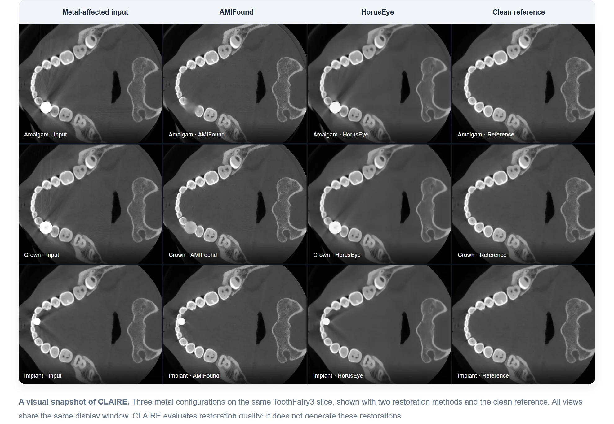
</p>

## The protocol: observe → lock → consult → audit

<p align="center">
  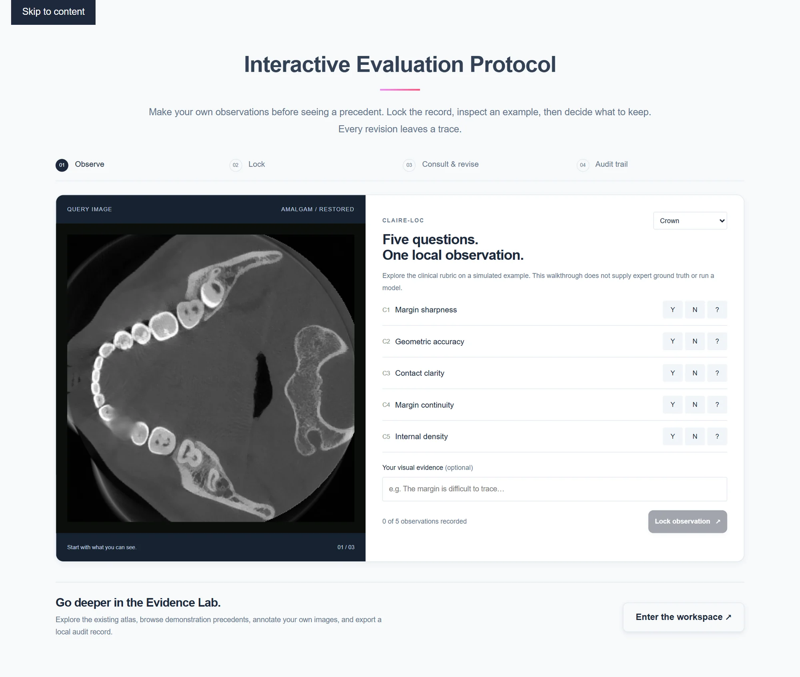
</p>

1. **Observe** — five binary items for the crown (margin sharpness, geometric accuracy, contact
   clarity, margin continuity, internal density) and five for adjacent anatomy.
2. **Lock** — the original answers are committed before any reference is shown.
3. **Consult** — precedents from *different patients and different folds* become available.
4. **Audit** — a revision requires written visual evidence; the original record is never deleted.

"Cannot determine" is stored as `null`, never coerced to `no` or to zero. New visitor ratings are
marked `pending_review`, because an unverified local annotator is not expert ground truth.

## Benchmark composition

<p align="center">
  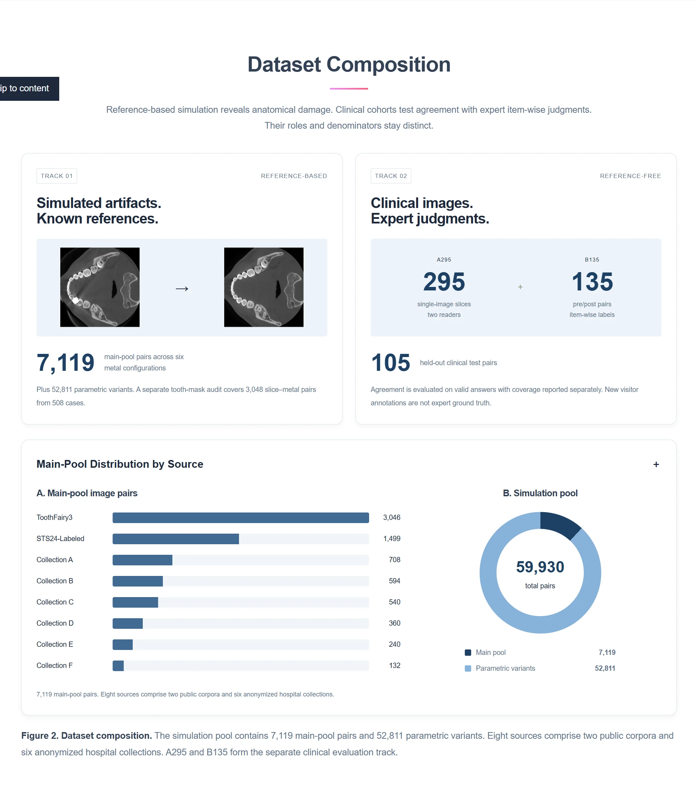
</p>

The simulation pool tests **known-reference** boundary preservation; the clinical cohorts test
agreement with **item-wise expert judgments**. Their roles and denominators stay separate, and
agreement is always reported next to valid coverage.

## Results

<p align="center">
  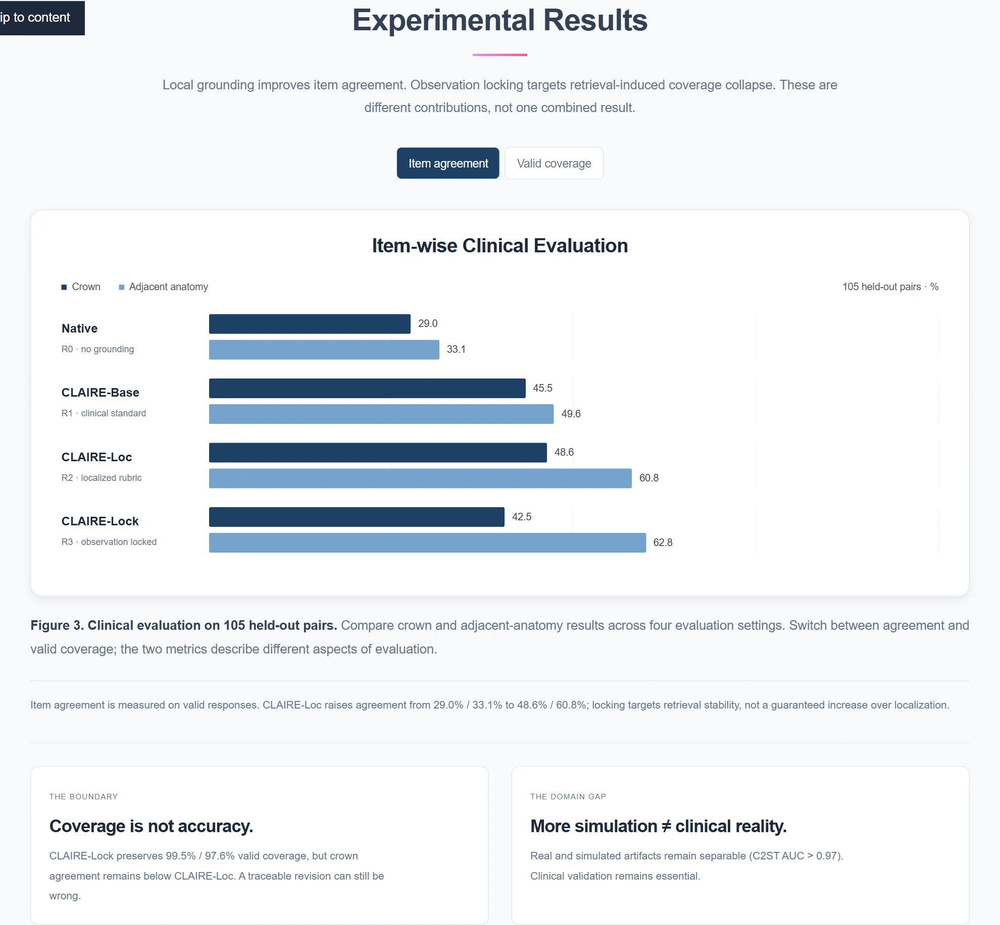
</p>

Local grounding improves item agreement. Observation locking targets retrieval-induced coverage
collapse. These are two different contributions, not one combined win.

- CLAIRE-Lock preserves **99.5% / 97.6%** valid coverage, but crown agreement remains below
  CLAIRE-Loc — a traceable revision can still be wrong.
- Real and simulated artifacts remain separable (**C2ST AUC > 0.97**), so simulation alone is not
  a substitute for clinical validation.
- Coverage is not accuracy, and BF1 deterioration is reported separately from joint SSIM–BF1
  conflicts.

## 3D reference anatomy

Twelve public cases as interactive, downloadable surfaces: four ToothFairy3 volumes with teeth,
pulp, jaws, mandibular canals, maxillary sinuses and airway; four STS24 FDI tooth instances; four
STS25 tooth and pulp/root-canal classes. Drag to rotate, scroll to zoom, toggle layers and jaw
opacity, or take a fixed view.

<p align="center">
  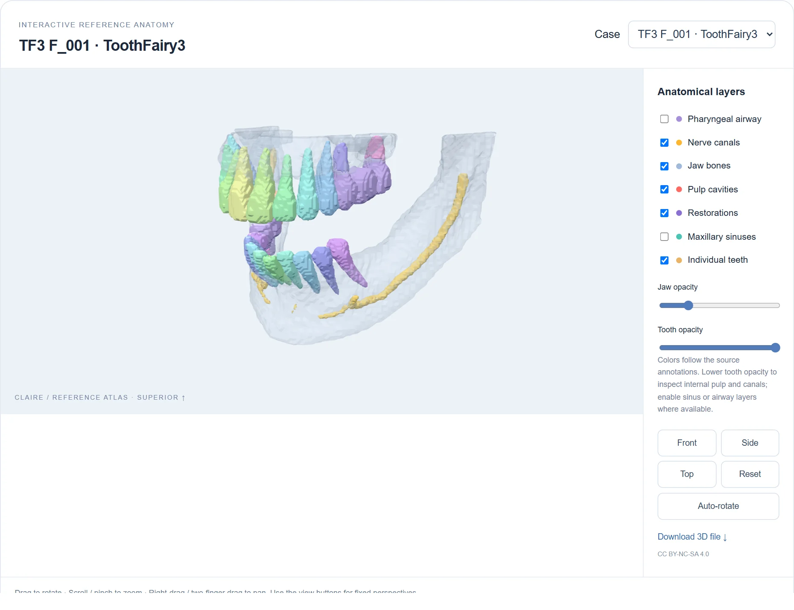
</p>

<table>
  <tr>
    <td align="center">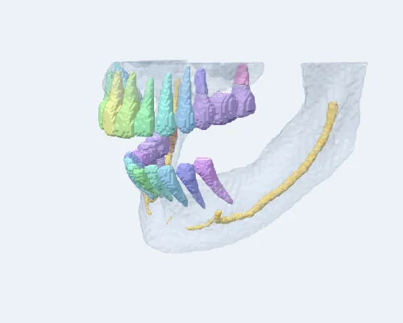<br><sub><b>ToothFairy3 F_001</b><br>multi-structure</sub></td>
    <td align="center">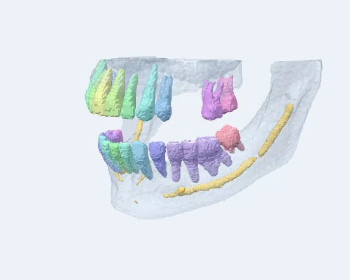<br><sub><b>ToothFairy3 F_002</b><br>multi-structure</sub></td>
    <td align="center">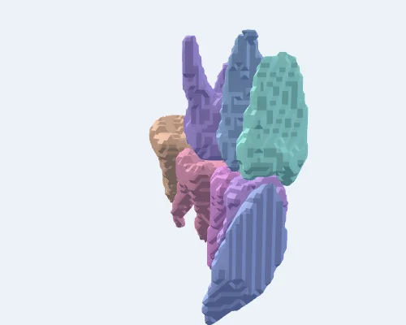<br><sub><b>STS24 0001</b><br>FDI tooth instances</sub></td>
    <td align="center">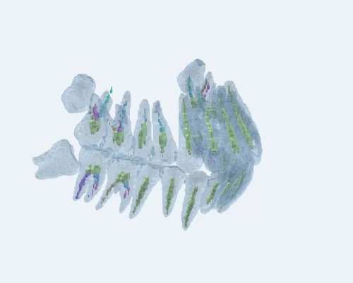<br><sub><b>STS25 0011</b><br>tooth + pulp classes</sub></td>
  </tr>
</table>

<p align="center">
  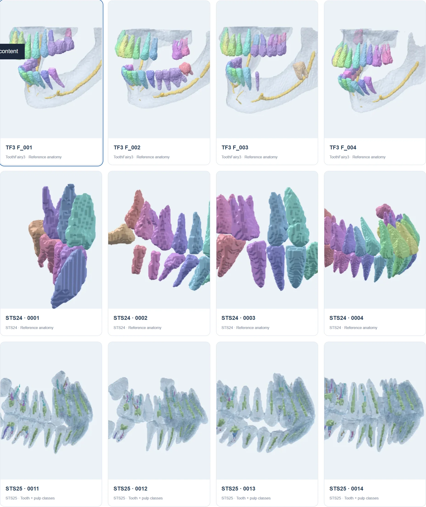
</p>

Upper/lower orientation is verified against FDI tooth labels; selected ToothFairy3 meshes require a
180° rigid X rotation relative to their header. Meshes are display derivatives (2-voxel sampling,
light Gaussian smoothing, marching cubes) — not voxel annotations and not quantitative measurement
tools. See [attribution and processing](anatomy-v2/ATTRIBUTION.txt).

## Evidence Lab: real slices, no invented labels

<p align="center">
  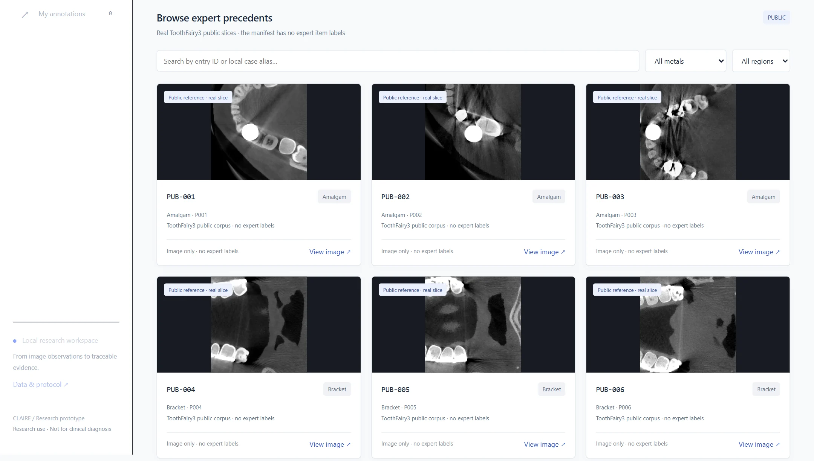
</p>

The published Evidence Lab is a **static** build over real public-source slices — 18 ToothFairy3
cases plus six clean/degraded metal pairs. Each card states what it is: *public reference · real
slice*, *image only · no expert labels*. Nothing is fabricated to fill a table.

<p align="center">
  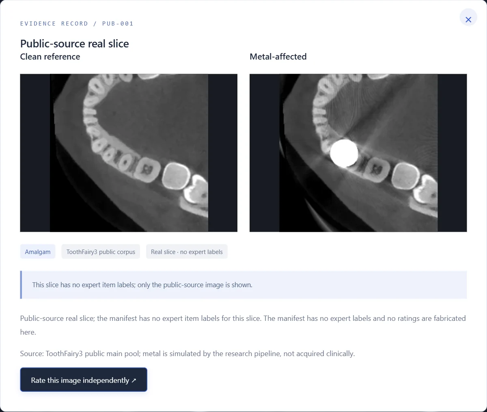
</p>

You can still rate any slice yourself: uploads and ratings stay in your browser's IndexedDB, the
protocol still locks your first observation, and exports are explicitly marked as unverified and
image-free. Precedent cards inside the walkthrough are labelled synthetic teaching examples.

## Repository layout

```
index.html            project page (hero, cases, 3D atlas, protocol, benchmark, results)
assets/               public slice pairs, provenance manifest, favicon
anatomy-v2/           interactive GLB meshes, animated previews, case manifest
lab/                  Evidence Lab: app, styles, i18n, static API, public slices
  api/                library.json + simulation.json consumed by the static build
  cases/ , sim/       rendered public slices (ToothFairy3 only)
  ATTRIBUTION.txt     per-slice provenance and display-window rules
docs/                 README-only screenshots (not linked from the site)
vendor/               three.js 0.170.0 and loaders (MIT)
site.css · academic.css · anatomy.css · lab-theme.css
robots.txt · sitemap.xml · .nojekyll
```

## Run locally

The site is plain static files — no build step, no dependencies:

```sh
python -m http.server 8772
# then open http://127.0.0.1:8772/
```

GitHub Pages publishes the `main` branch root. `.nojekyll` keeps the `anatomy-v2/` and `lab/`
paths intact.

## Content, scope and limitations

- Displayed slices derive from the public **ToothFairy3** corpus. Simulated metal inputs and
  AMIFound / HorusEye outputs share slice geometry and a fixed stored-intensity window
  (−1024 to 3072) — this is **not** calibrated HU.
- Clinical hospital images, patient records, credentials and manuscript PDFs are **not** part of
  this repository. The 430-entry clinical expert library stays on local storage and is never
  uploaded.
- The site does not run restoration models or vector retrieval. Model outputs are precomputed
  assets; slider and protocol interactions are precomputed demonstrations.
- Visitor annotations remain in the browser. Exported JSON is not expert validation.
- Research demonstration only — not a diagnostic device.
- Hugging Face and ModelScope badges on the site remain *Coming soon*; no repositories are linked.

## Attribution and license

- **ToothFairy3** derivatives (slices, meshes, previews): CC BY-NC-SA 4.0 —
  Bolelli et al., *Segmenting Maxillofacial Structures in CBCT Volumes*, CVPR 2025, and the
  ToothFairy3 challenge.
- **STS24 / STS25 (STSR 2025 Task 1)** — retain their respective source dataset terms.
- **three.js 0.170.0** — MIT, see [vendor/THREE-LICENSE.txt](vendor/THREE-LICENSE.txt).
- ModelScope icon — official website favicon, used for identification only.

Non-commercial research and review use. A code license will accompany the public release; until
then no license is granted for reuse of the source files.

## Citation

```bibtex
@misc{claire2027,
  title        = {CLAIRE: Clinically-Aligned and Auditable Quality Evaluation
                  for Dental CBCT Reconstruction},
  year         = {2027},
  howpublished = {\url{https://ricoleehduu.github.io/CLAIRE/}},
  note         = {Manuscript under review}
}
```

<div align="center">
<sub>Built as a static research showcase · no tracking, no third-party analytics, no clinical data.</sub>
</div>
